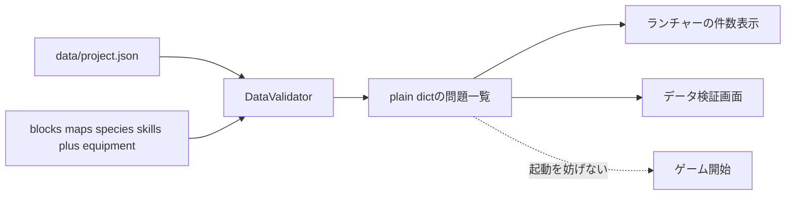

# MODデータ一括検証機能説明書

## 目的

フォルダへ追加したMODデータに参照ミスや入力間違いがあっても、最初の1件でゲームを例外終了させず、発見した問題をまとめて表示します。検証は読取り専用で、JSONを自動修正しません。

## 責務分離

| 層 | 責務 |
|---|---|
| `data/project.json` | ゲーム固有の有効なID・分類語彙を定義 |
| `data/data_validator.py` | pygame非依存で全問題を収集 |
| `apps/data_validator.py` | 問題一覧の描画、スクロール、再検査 |
| `apps/launcher.py` | 起動時の件数表示と検証画面の起動 |
| 各データエディタ | 保存直後に再検査し、問題件数をステータス表示 |

## 検査内容

- JSON構文、必須ファイル、最上位の型
- ブロックID、ファイル名、3種類の真偽値ルール
- 種族IDとフォルダ名、Lv1〜100の6能力
- 習得表と＋選択肢が参照するスキルID
- ＋分岐の `requires_any / requires_all` が参照する選択肢ID
- 耐性名と耐性段階
- 装備カテゴリ、装備可能種族、能力・スキル・耐性参照
- マップ寸法、未知ブロック、出現種族、固定モブ種族、移動先マップ

各問題は `severity / code / path / message` だけを持つプレーンな辞書です。pygameオブジェクトや例外をUI境界へ渡さないため、将来別エンジンやCLIからも同じ検証結果を利用できます。

## 起動継続

検証結果は警告として扱います。ランチャーは件数を表示しますが、ゲーム開始ボタンを無効化しません。ブロック・マップ・モンスターエディタも保存直後に全体を再検査し、問題があれば件数を表示します。MOD作者は検証画面でJSONパスを確認し、修正後に `F5` で再検査できます。
