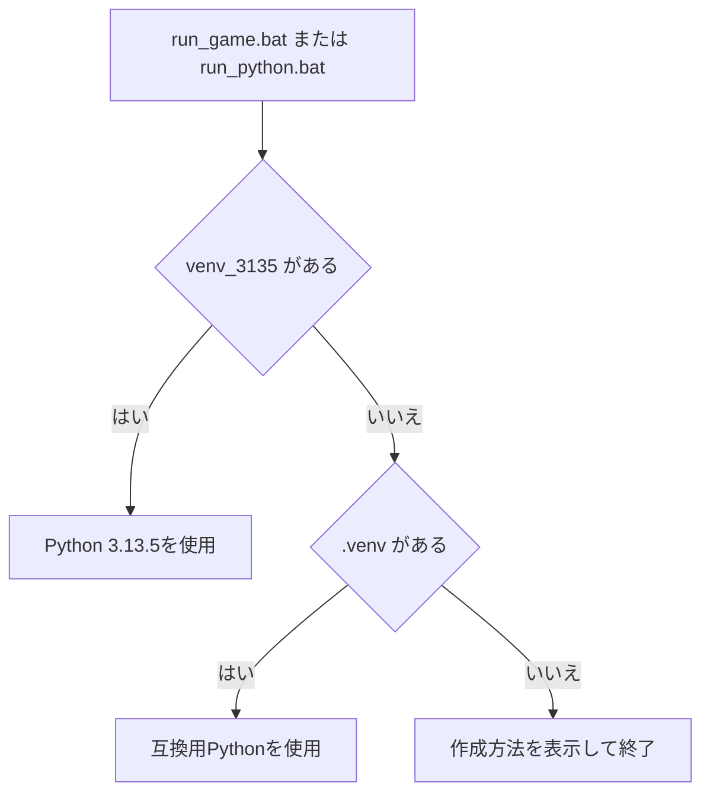

# Python 3.13.5並行環境機能説明書

## 目的

Python 3.13.5用の `venv_3135` を通常の実行環境にしながら、既存の `.venv` をPython 3.10互換確認用として残します。仮想環境の違いは起動境界で吸収し、ゲームロジックや公開JSON形式へPythonバージョン固有の条件分岐を持ち込みません。

## 実行環境の選択



`scripts/run_python.bat` が次の順でPythonを選びます。

1. `venv_3135/Scripts/python.exe`
2. `.venv/Scripts/python.exe`

3.13.5環境ではpygame同梱DLLの場所とWindowsの基本ディレクトリだけを優先PATHへ設定します。修復中または切断中のドライブに残ったPython/SDL DLLを誤って読み込まないためです。

## セットアップ

```powershell
py -3.13 -m venv venv_3135
venv_3135\Scripts\python.exe -m pip install -r requirements.txt
```

起動とテストは同じ選択ラッパーを使います。

```powershell
scripts\run_python.bat launcher.py
scripts\run_python.bat -m unittest discover -s tests -v
```

## 移植性の境界

- `pyproject.toml` の対応範囲は引き続き `Python >= 3.10` とします。
- Pythonバージョンの選択はBATと開発手順だけが担当します。
- `src/kadoka_quest`、`data`、`savedata` の契約は変更しません。
- 将来GDScriptやLuaなどへ移植するときも、JSONとpygame非依存コアの入出力契約をそのまま参照できます。
- 仮想環境フォルダはGit管理せず、各PCで再作成します。
