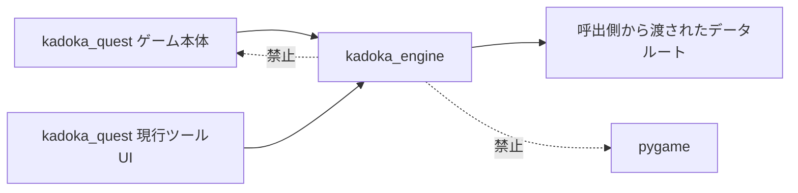

# エンジン分離第1段階機能説明書

## 目的

Kadoka Quest固有コードと、別のRPGでも利用できる処理を同じPythonパッケージに増やし続けないため、リポジトリ内に再利用可能エンジンの依存境界を作ります。最初の抽出対象は、ゲーム固有ルールを `data/project.json` から受け取れるMODデータ検証です。

## パッケージ境界



| パッケージ | 現在の責務 |
|---|---|
| `kadoka_engine` | ゲーム名・pygame・固定パスを知らない再利用処理 |
| `kadoka_quest` | Kadoka Questのデータルート、ゲーム進行、現行pygame UI |
| `kadoka_quest.data.data_validator` | 旧importとの互換窓口 |

## DataValidatorの変更

汎用版 `DataValidator` はデータルートを必須引数として受け取ります。これによりエンジンは `kadoka_quest.paths` やモジュールレベルのグローバルパスを参照しません。

```python
from kadoka_engine.data_validator import DataValidator

issues = DataValidator(project_data_root).validate()
```

既存コードやMODツールが利用している可能性がある次のimportは、互換アダプターとして維持します。

```python
from kadoka_quest.data.data_validator import DataValidator
```

## 自動検査する境界

テストは `src/kadoka_engine/**/*.py` を読み、次を禁止します。

- `kadoka_quest` のimportまたは参照
- `pygame` のimportまたは参照

第2段階ではフィールド規則と各フィールド用コントローラーを同じ依存方向のまま移しました。詳細は `docs/フィールドエンジン分離第2段階機能説明書.md` を参照してください。戦闘進行やツール専用GUIの分離は後続段階で行うため、評価者の3層分離フィードバックは未完了として残します。
