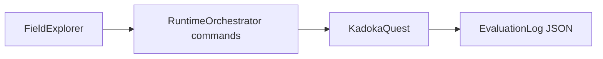

# ゲーム評価モード

`game_evaluator.py` は、長時間の探索確認用にゲーム本体をヘッドレスで操作する開発者CLIです。キーボードイベントや描画座標を直接操作せず、通常画面と共通の意味コマンドを通します。



## 実行

```powershell
scripts\run_python.bat game_evaluator.py --steps 2000 --output reports\game_evaluation.json
```

| 引数 | 既定値 | 内容 |
| --- | --- | --- |
| `--steps` | `2000` | 最大操作回数 |
| `--output` | `reports/game_evaluation.json` | JSONログの保存先 |
| `--save-dir` | 出力先横の`evaluator_save` | 評価専用のセーブ保存先 |

未訪問マップを行き先に持つ移動イベントを先に選び、次に未調査イベントを幅優先探索します。到達不能な経路は一度 `blocked` として記録して候補から外します。イベントがない、または到達できない場合は `stalled` と `no_reachable_event` を残して安全に終了します。

戦闘に入った場合はAI戦闘を進め、暗号入力が必要な場合は推測入力をせず取消として記録します。評価モードは通常のプレイヤー入力仕様を変更しません。
