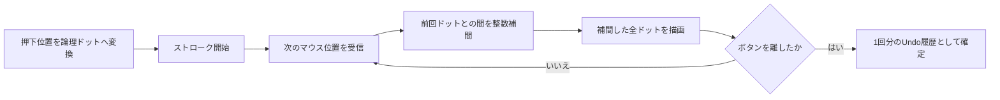

# ドットエディタ連続描画機能説明書

## 目的

ペンを速くドラッグしてOSから届くマウス移動イベントの間隔が広がっても、途中のドットを飛ばさず連続した線として描画します。モンスターエディタとブロックエディタは同じ `PixelArtEditor` を利用するため、両方へ同じ挙動が適用されます。

## 処理の流れ

補間は表示倍率やパン位置ではなく、画像本来の論理座標上で行います。そのため、1×1から128×128までキャンバス解像度が変わっても同じ処理を利用できます。

## 境界動作

| 状況 | 動作 |
|---|---|
| 左ドラッグ | 選択色で連続描画 |
| 右ドラッグ | 透明色で連続消去 |
| 高速移動 | 前回と現在の間を整数直線で補間 |
| キャンバス外へ移動 | 前回位置を破棄 |
| キャンバスへ再進入 | 再進入位置から新しい線分を開始 |
| `Ctrl+Z` | ドラッグ全体を1回で取り消す |

中央ボタンはペン入力として扱いません。表示位置の移動は従来どおり「表示移動」モードの左ドラッグが担当します。
