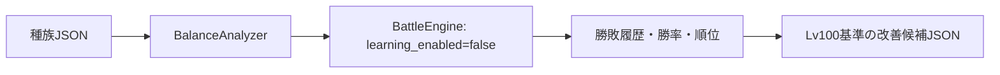

# バランス調整ツール

`balance_analyzer.py` は開発者向けのCLIです。戦闘画面を起動せず、既存の `BattleEngine` をAI学習無効で繰り返し実行します。種族・スキル・能力値・耐性のJSONを書き換えることはありません。



## 実行

```powershell
scripts\run_python.bat balance_analyzer.py --levels 1,25,50,75,100 --battles 20 --seed 1
```

| 引数 | 既定値 | 内容 |
| --- | --- | --- |
| `--levels` | `1,25,50,75,100` | 比較する同レベル帯 |
| `--battles` | `20` | 種族ペア・レベルごとの戦闘数 |
| `--seed` | `1` | 再現用乱数seed |
| `--max-rounds` | `80` | 引分扱いにするターン数 |
| `--species` | 全種族 | 対象を限定する種族ID |
| `--output` | `reports/balance_report.json` | 出力先 |

出力JSONは各対戦のseed、勝者、ターン数を `matchups[].history` に残します。`rankings` は集計済みの勝率と順位、`recommendations` は十分な対戦数で勝率差が大きい場合だけ出る提案です。

提案はLv100の能力値を調整アンカーとし、`level_100_delta` を出します。これは調整担当者が既存のLv別能力表へ反映するための候補であり、自動適用はしません。耐性候補にも根拠量から算出した `low / medium / high` の信頼度を付けます。
