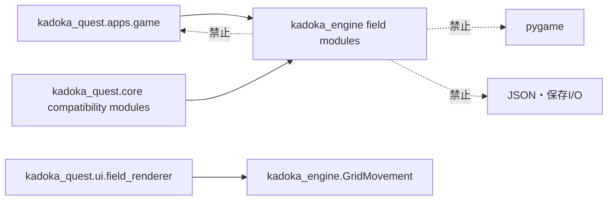

# フィールドエンジン分離第2段階機能説明書

## 目的

フィールド探索のうち、Kadoka Questの固有ストーリーや保存形式を知らなくても動作する処理を `kadoka_engine` へ移します。ゲーム本体は汎用エンジンへマップ・ブロック・時刻・座標などのプレーンデータを渡します。

## 依存方向

## 移動した責務

| モジュール | 責務 |
|---|---|
| `field_engine.py` | 通行、正面座標、イベント・キャラクター検索 |
| `grid_movement.py` | グリッド座標間の表示補間 |
| `fixed_mob_controller.py` | 固定モブの占有、会話デッキ、移動周期 |
| `hidden_enemy_controller.py` | 見えない敵の生成、視認、追跡・徘徊周期 |
| `player_field_controller.py` | 主人公座標、向き、長押し、表示補間 |

## 互換性

従来の `kadoka_quest.core.field_engine` など5つのモジュールは、同名のエンジンクラスを再公開します。旧クラスと新クラスはコピーではなく同一オブジェクトであり、既存のimport、型判定、保存データ、公開メソッドは変わりません。

## 境界テスト

- `kadoka_engine` が `kadoka_quest` とpygameをimportしないこと
- 旧importと新importが同じクラスを返すこと
- フィールド移動、固定モブ、見えない敵、長押し、補間の既存テストが同じ結果になること

戦闘処理、イベントアプリ、ツールGUIにはまだKadoka Quest側の責務が残っています。3層分離全体が完了するまでは評価者フィードバックを未完了として維持します。
