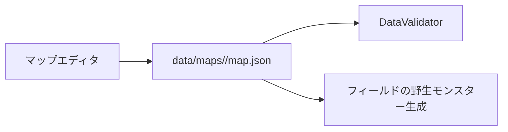

# 出現モンスターレベル範囲

マップごとの野生モンスターのLv範囲は、ゲーム本体とマップエディタが同じ `map.json` を直接使います。

## 編集方法

以下は通常域の固定Lv編集です。`encounter_context: metal_area` の地域は、この固定範囲ではなく遭遇時のパーティからLvを算出します。詳細は [メタルエリア動的レベル機能説明書.md](メタルエリア動的レベル機能説明書.md) を参照してください。

マップエディタで「出現Lv設定」を開き、左の種族を選んで最小Lv・最大Lvを入力し、「範囲を設定」を押します。

| 操作 | 結果 |
| --- | --- |
| 未登録の種族に範囲を設定 | 重み10の出現項目として追加 |
| 登録済みの種族に範囲を設定 | 既存項目の範囲だけを更新 |
| 出現表から削除 | その種族の項目を削除 |

`min_level` と `max_level` はともに 1〜100 の整数で、最小値は最大値以下です。不正な値は設定できず、保存前のデータ検証でも検出されます。`ball_slime` は初期獲得専用なので、この画面でもJSON検証でも野生出現を拒否します。
