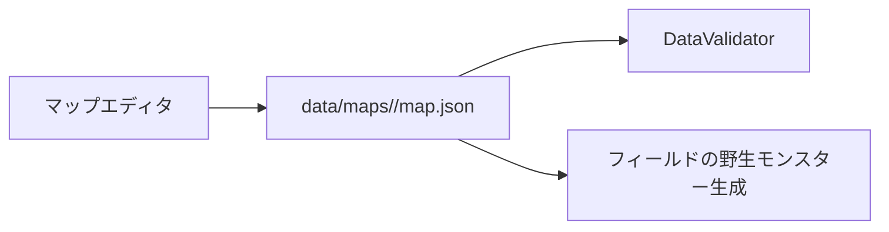

# 出現モンスターレベル範囲

マップごとの野生モンスターのLv範囲は、ゲーム本体とマップエディタが同じ `map.json` を直接使います。

## 編集方法

以下は通常域の固定Lv編集です。`encounter_context: metal_area` の地域は、この固定範囲ではなく遭遇時のパーティからLvを算出します。詳細は [メタルエリア動的レベル機能説明書.md](メタルエリア動的レベル機能説明書.md) を参照してください。

マップエディタで「出現テーブル」を開き、左の候補を選んで最小Lv・最大Lvを入力し、「編集を反映」を押します。「マップ保存」でJSONへ保存します。種族・重みの編集やスクロール等の詳細は [野生出現テーブル編集機能説明書.md](野生出現テーブル編集機能説明書.md) を参照してください。

| 操作 | 結果 |
| --- | --- |
| 新規候補に範囲を設定 | 入力した重み・種族・Lvで追加（初期値は重み10、Lv1〜5） |
| 既存候補を編集 | 選択行の種族・重み・範囲を更新。追加JSON項目は保持 |
| 選択を削除 | 選択した1行だけ削除 |

`min_level` と `max_level` はともに 1〜100 の整数で、最小値は最大値以下です。不正な値は設定できず、保存前のデータ検証でも検出されます。`ball_slime` は初期獲得専用なので、この画面でもJSON検証でも野生出現を拒否します。
