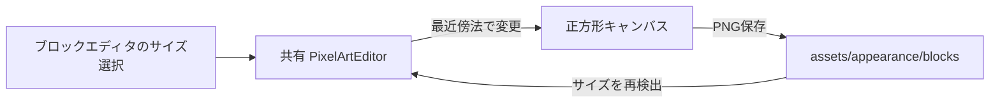

# 可変キャンバス機能説明書

ブロック画像を、共有ドットエディタから 1 / 2 / 4 / 8 / 16 / 32 / 64 / 128 ピクセルの正方形キャンバスで編集できるようにする機能です。初期値は64×64です。

| 対象 | 保存サイズ | 理由 |
| --- | --- | --- |
| ブロック画像 | 1〜128の選択値 | 単色タイルは1×1、細部が必要なタイルは128×128で直接管理できるようにするため |
| モンスター立ち絵・前後左右 | 64×64固定 | ゲーム内の統一されたドット絵契約と既存の最近傍表示を維持するため |

サイズボタンを押すと、現在のブロック画像を最近傍法で新しい正方形へ変換します。これは1回のUndoとして扱われ、保存するまでPNGは変更されません。保存後に再び開いた場合は、PNGの実際の正方形サイズを読み取って編集キャンバスへ戻します。

対応外の値は保存・変換できません。これにより、整数グリッド描画、PNGの非ぼかし表示、既存のブロックJSON形式を変えずに保ちます。
