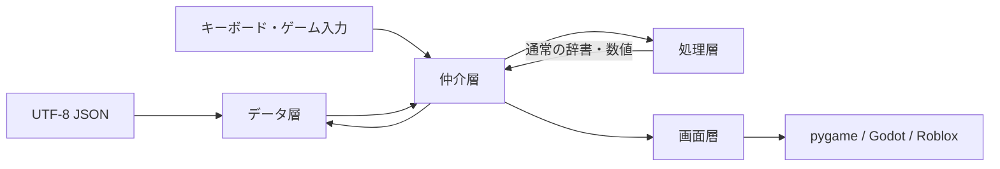

# 移植境界機能説明書

## 目的

pygame版からGodotのGDScript版またはRobloxのLua版へ移行するとき、ゲームルール・画面表示・永続データを混ぜずに段階的に置き換えられる構造を維持する。

## レイヤー境界

| レイヤー | Pythonでの主な場所 | 責務 | 移植時の扱い |
|---|---|---|---|
| データ | `data/`、`data/repository.py`、`data/*Store.py` | UTF-8 JSONの読込・保存と検証 | JSON形式は維持し、各環境のファイル／DataStore APIへ接続する |
| 処理 | `core/` | 移動、戦闘、能力値、AIなどのルール | 同じ入力と出力をGDScript／Luaで再実装する |
| 画面 | `ui/` | 描画、ウィジェット、画像の拡大縮小 | Godot Control/Node2DまたはRoblox GUIへ置き換える |
| 仲介 | `apps/` | 入力を処理層へ渡し、結果に応じて保存・画面遷移する | 各エンジンのScene/Controllerに置き換える |

pygame固有型は `ui/` と入力受付を行う `apps/` の外へ渡さない。処理層の公開入出力は数値、文字列、真偽値、リスト、辞書のみとする。

## フィールド処理の移植契約

`core/field_engine.py` の `FieldEngine` はpygameとファイルI/Oへ依存しない。マップ辞書とブロック辞書を受け取り、フィールドの空間ルールだけを判定する。

`resolve_player_move` は元の座標を変更せず、次の形式の辞書を返す。

| キー | 内容 |
|---|---|
| `kind` | `moved` または `blocked` |
| `reason` | `walkable`、`out_of_bounds`、`hidden_character`、`visible_character`、`blocking_event`、`blocked_tile` |
| `x`, `y` | 判定後の論理マス座標。失敗時は元の座標 |
| `direction` | `left`、`right`、`back`、`front` |
| 追加情報 | 必要に応じて `character`、`event`、`block_id`、`block` |

処理層は戦闘開始、メッセージ文面、セーブ、アニメーションを実行しない。`apps/game.py` が結果を解釈して、それぞれの処理へ接続する。

フィールド描画は `ui/field_renderer.py` にあり、論理マス座標と `GridMovement` の表示座標を読むだけでゲーム状態を変更しない。マップイベントは描画レイヤーを持たず、地形の色を変更しない。

## 移植手順

1. 現行JSONを新環境で読み、辞書相当の値へ変換する。
2. `FieldEngine` とほかの `core/` のテストケースを同じ入出力で移植する。
3. 新しい画面層を実装し、処理結果だけを描画する。
4. Scene/Controllerで入力、処理、保存、画面遷移を接続する。
5. Python版と同じサンプルJSONを使い、移動可否・イベント・戦闘結果の一致を確認する。

GDScriptやLuaに都合のよい画面情報をJSONへ追加しない。表示だけに必要な一時状態は画面層、ゲーム進行に必要な状態だけをセーブデータへ置く。

## 第1段階: GDScript版の開始（2026-10-02）

`gdscript/project.godot` にsource専用の独立したGodotプロジェクトを追加した。既存の `data/` と `assets/` を読むが、保存データとPythonランタイムへ依存しない。初回は空間ルールの移植とフィールドSceneの接続だけを対象とする。#111の開始ディレクトリも用意し、Python本体の移動（#112～#114）はまだ行わない。

実行経路は `field_application` → repository/session → view。`gdscript/engine/field_engine.gd` は現行正本 `src/kadoka_engine/field_engine.py` のmove/front/transition/nearby/tile/path契約を再実装し、同一入力を実GodotとPythonで比較する。`tests/test_gdscript_bootstrap.py` から追加イベントJSON、正本の不変性、キーの押下・リピート・解放、実Sceneのstep/interact接続も検証する。Godotがない環境のskipは成功の証拠にしない。

未移植機能を代替の成功処理で埋めない。第1段階では固定モブは初期地点の静止表示のみ、戦闘/野生敵/AI/セーブ/暗号取得/牧場/エディタは未移植と明示した。現在の起動手順と配布export未検証の境界は [GDScript README](../gdscript/README.md) を正とする。Python版の挙動・正規data/assetsは変更しない。

## 第2段階: フィールドの保存／復元（2026-10-02）

F5保存、F9読込、次回起動時の現在地・向きの復元を追加した。純粋な `field_save_contract` は辞書の検証と組立のみ、`json_documents / field_save_store` はI/O、`field_persistence` は調停、Sceneは検証済みの結果だけをsessionへ適用する。不正な読込で一時状態を変更しない。

保存は既定の `user://savedata/<name>/` に分離し、Python版と同じstate/items/monsters/parties形式を使う。既存の個体・AI・所持品・meta・プリセットは読み替え/上書きせず、stateの位置以外のキーも引き継ぐ。旧stateには向きがないため正面扱いとする。これは位置の互換性に限られ、個体生成・AI学習・戦闘・牧場やセーブスロットUIまで移植済みという意味ではない。

実Godotの入力と別プロセス再起動、旧Python形式、名前付き保存の独立、壊れたJSON/位置、digest不一致、Windowsの実ファイルロックによる置換失敗を専用コピーで検証する。以前のstateを削除する置換fallbackは使わない。複数ファイルの初回作成の一括原子性や、並行実行中の複数writerの排他は保証しない。手動ウィンドウ操作・exportは別の検証段階に残る。

## 第3段階: 初期個体／所有一覧（2026-10-03）

新規stateの初回F5で主人公・ボールスライムと初期パーティを生成する。個体/初期AIの純粋な辞書契約をengine、フォルダ読込と新規2ファイルの公開をdata、種族検証とゲーム固有の初期仲間選択をapplicationに分離した。state保存失敗後の完全な個体フォルダは再試行で再利用し、既存個体を上書きしない。複数ファイルの全体トランザクションではない。

F6の読み取り専用一覧へ全保有個体と先頭4パーティ枠を渡す。UIはscrollbar/キーと表示だけを担当し、画面中の移動/調べる/保存を止める。日本語個体ID、学習済み/未知キー付きAI、＋選択・装備IDを保持する。欠損/破損は警告して元ファイルやparty IDを残す。初期AIと個体作成のPython契約比較、実SceneのF6/スクロール/入力停止、保存・再起動を専用領域で検証する。

能力値/スキル/＋効果/装備補正の再構築、AI推論・学習・リセット、編成変更、牧場/外部取得/模擬戦は未移植。既存stateへ仲間を勝手に追加せず、前段階の空セーブも自動修復しない。今回をこれらの完成やPython E2Eカタログの全面移植とは扱わない。

## 第4段階: 現在パーティ編成（2026-10-03）

F6一覧からE/ボタンで編成画面を開き、4枠へ個体を追加/解除/配置変更できるようにした。`party_selection` は純粋な下書きと選択規則、`party_editor` は下書きの所有・保存前の再走査/再検証、`party_view` は選択/フォーカス/スクロールと操作signal、Sceneは結果表示と接続だけを担当する。保存/キャンセルを分け、編成中のフィールド操作を止める。

保存はPython互換の `state.json.current_party` だけを4枠のID/null配列に変更する。他のstateキーと個体/AI/items/meta/プリセットは変更しない。重複/欠損を拒否し、既存の問題枠は明示解除で対応する。不正型/5枠以上を黙って切り捨てない。外部更新は編集開始時のdigestと比較して拒否し、失敗後も下書きを残す。変更なし/キャンセルはstateを書き直さない。

実Godotのキーボード/クリック経路、保存・別プロセス再起動、Python形式と未知キー/個体AIの保持、多数個体の一覧、外部更新/破損・個体消失・Windows置換ロックを専用コピーで検証する。UPD/performance checkerは既存Pythonの退行検査で、GDScript性能/全責務の検証ではない。プリセット、牧場導線、個体編集、戦闘/AIは引き続き未移植。手動ウィンドウ操作と配布exportは別段階に残る。

## 第5段階: パーティプリセット（2026-10-03）

編成のP/ボタンからプリセットの新規保存・一覧・選択読込を追加した。純粋なparty_preset_contractが形式/名前/欠損枠を検証し、party_preset_storeがJSONの一覧/読込/新規作成、party_presetsが再走査と編成下書きへの適用、party_preset_viewが入力/表示/signalを担当する。新規ファイルはPythonと同じschema/name/members形式で、同名を別ファイルとして追加する。既存ファイルの上書き・削除は行わず、枠数に上限を設けない。

読込は現在パーティの下書きだけを変え、state保存は編成画面で別に明示する。消失/読込不可の個体は注意付きnullに変換し、既知個体の重複・不正型・5枠以上・破損JSON等では適用しない。一覧後にも実ファイルと個体を読み直す。新規保存だけでstate/個体AIを変更せず、編成キャンセルで明示保存済みのプリセットを削除しない。

実Sceneのキー/クリック、名前編集/フォーカス/121ファイルのスクロール、再起動とPython形式の読込、外部更新/破損/Windows読込ロック、partiesがファイルである異常状態での失敗とデータ不変を専用コピーで検証する。実IME/ウィンドウの視認性・配布exportは未検証。並行writer排他、プリセット更新/削除、牧場導線・個体編集・戦闘/AIは次段階に残し、Python E2Eカタログの全面移植や#204完了とは扱わない。
