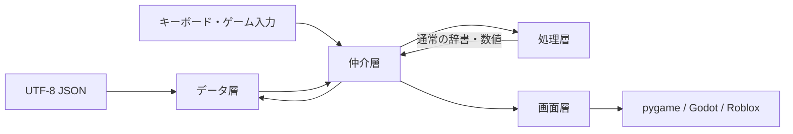

# 移植境界機能説明書

## 目的

pygame版からGodotのGDScript版またはRobloxのLua版へ移行するとき、ゲームルール・画面表示・永続データを混ぜずに段階的に置き換えられる構造を維持する。

## レイヤー境界

| レイヤー | Pythonでの主な場所 | 責務 | 移植時の扱い |
|---|---|---|---|
| データ | `data/`、`data/repository.py`、`data/*Store.py` | UTF-8 JSONの読込・保存と検証 | JSON形式は維持し、各環境のファイル／DataStore APIへ接続する |
| 処理 | `core/` | 移動、戦闘、能力値、AIなどのルール | 同じ入力と出力をGDScript／Luaで再実装する |
| 画面 | `ui/` | 描画、ウィジェット、画像の拡大縮小 | Godot Control/Node2DまたはRoblox GUIへ置き換える |
| 仲介 | `apps/` | 入力を処理層へ渡し、結果に応じて保存・画面遷移する | 各エンジンのScene/Controllerに置き換える |

pygame固有型は `ui/` と入力受付を行う `apps/` の外へ渡さない。処理層の公開入出力は数値、文字列、真偽値、リスト、辞書のみとする。

## フィールド処理の移植契約

`core/field_engine.py` の `FieldEngine` はpygameとファイルI/Oへ依存しない。マップ辞書とブロック辞書を受け取り、フィールドの空間ルールだけを判定する。

`resolve_player_move` は元の座標を変更せず、次の形式の辞書を返す。

| キー | 内容 |
|---|---|
| `kind` | `moved` または `blocked` |
| `reason` | `walkable`、`out_of_bounds`、`hidden_character`、`visible_character`、`blocking_event`、`blocked_tile` |
| `x`, `y` | 判定後の論理マス座標。失敗時は元の座標 |
| `direction` | `left`、`right`、`back`、`front` |
| 追加情報 | 必要に応じて `character`、`event`、`block_id`、`block` |

処理層は戦闘開始、メッセージ文面、セーブ、アニメーションを実行しない。`apps/game.py` が結果を解釈して、それぞれの処理へ接続する。

フィールド描画は `ui/field_renderer.py` にあり、論理マス座標と `GridMovement` の表示座標を読むだけでゲーム状態を変更しない。マップイベントは描画レイヤーを持たず、地形の色を変更しない。

## 移植手順

1. 現行JSONを新環境で読み、辞書相当の値へ変換する。
2. `FieldEngine` とほかの `core/` のテストケースを同じ入出力で移植する。
3. 新しい画面層を実装し、処理結果だけを描画する。
4. Scene/Controllerで入力、処理、保存、画面遷移を接続する。
5. Python版と同じサンプルJSONを使い、移動可否・イベント・戦闘結果の一致を確認する。

GDScriptやLuaに都合のよい画面情報をJSONへ追加しない。表示だけに必要な一時状態は画面層、ゲーム進行に必要な状態だけをセーブデータへ置く。

## 第1段階: GDScript版の開始（2026-10-02）

`gdscript/project.godot` にsource専用の独立したGodotプロジェクトを追加した。既存の `data/` と `assets/` を読むが、保存データとPythonランタイムへ依存しない。初回は空間ルールの移植とフィールドSceneの接続だけを対象とする。#111の開始ディレクトリも用意し、Python本体の移動（#112～#114）はまだ行わない。

実行経路は `field_application` → repository/session → view。`gdscript/engine/field_engine.gd` は現行正本 `src/kadoka_engine/field_engine.py` のmove/front/transition/nearby/tile/path契約を再実装し、同一入力を実GodotとPythonで比較する。`tests/test_gdscript_bootstrap.py` から追加イベントJSON、正本の不変性、キーの押下・リピート・解放、実Sceneのstep/interact接続も検証する。Godotがない環境のskipは成功の証拠にしない。

未移植機能を代替の成功処理で埋めない。第1段階では固定モブは初期地点の静止表示のみ、戦闘/野生敵/AI/セーブ/暗号取得/牧場/エディタは未移植と明示した。現在の起動手順と配布export未検証の境界は [GDScript README](../gdscript/README.md) を正とする。Python版の挙動・正規data/assetsは変更しない。

## 第2段階: フィールドの保存／復元（2026-10-02）

F5保存、F9読込、次回起動時の現在地・向きの復元を追加した。純粋な `field_save_contract` は辞書の検証と組立のみ、`json_documents / field_save_store` はI/O、`field_persistence` は調停、Sceneは検証済みの結果だけをsessionへ適用する。不正な読込で一時状態を変更しない。

保存は既定の `user://savedata/<name>/` に分離し、Python版と同じstate/items/monsters/parties形式を使う。既存の個体・AI・所持品・meta・プリセットは読み替え/上書きせず、stateの位置以外のキーも引き継ぐ。旧stateには向きがないため正面扱いとする。これは位置の互換性に限られ、個体生成・AI学習・戦闘・牧場やセーブスロットUIまで移植済みという意味ではない。

実Godotの入力と別プロセス再起動、旧Python形式、名前付き保存の独立、壊れたJSON/位置、digest不一致、Windowsの実ファイルロックによる置換失敗を専用コピーで検証する。以前のstateを削除する置換fallbackは使わない。複数ファイルの初回作成の一括原子性や、並行実行中の複数writerの排他は保証しない。手動ウィンドウ操作・exportは別の検証段階に残る。

## 第3段階: 初期個体／所有一覧（2026-10-03）

新規stateの初回F5で主人公・ボールスライムと初期パーティを生成する。個体/初期AIの純粋な辞書契約をengine、フォルダ読込と新規2ファイルの公開をdata、種族検証とゲーム固有の初期仲間選択をapplicationに分離した。state保存失敗後の完全な個体フォルダは再試行で再利用し、既存個体を上書きしない。複数ファイルの全体トランザクションではない。

F6の読み取り専用一覧へ全保有個体と先頭4パーティ枠を渡す。UIはscrollbar/キーと表示だけを担当し、画面中の移動/調べる/保存を止める。日本語個体ID、学習済み/未知キー付きAI、＋選択・装備IDを保持する。欠損/破損は警告して元ファイルやparty IDを残す。初期AIと個体作成のPython契約比較、実SceneのF6/スクロール/入力停止、保存・再起動を専用領域で検証する。

能力値/スキル/＋効果/装備補正の再構築、AI推論・学習・リセット、編成変更、牧場/外部取得/模擬戦は未移植。既存stateへ仲間を勝手に追加せず、前段階の空セーブも自動修復しない。今回をこれらの完成やPython E2Eカタログの全面移植とは扱わない。

## 第4段階: 現在パーティ編成（2026-10-03）

F6一覧からE/ボタンで編成画面を開き、4枠へ個体を追加/解除/配置変更できるようにした。`party_selection` は純粋な下書きと選択規則、`party_editor` は下書きの所有・保存前の再走査/再検証、`party_view` は選択/フォーカス/スクロールと操作signal、Sceneは結果表示と接続だけを担当する。保存/キャンセルを分け、編成中のフィールド操作を止める。

保存はPython互換の `state.json.current_party` だけを4枠のID/null配列に変更する。他のstateキーと個体/AI/items/meta/プリセットは変更しない。重複/欠損を拒否し、既存の問題枠は明示解除で対応する。不正型/5枠以上を黙って切り捨てない。外部更新は編集開始時のdigestと比較して拒否し、失敗後も下書きを残す。変更なし/キャンセルはstateを書き直さない。

実Godotのキーボード/クリック経路、保存・別プロセス再起動、Python形式と未知キー/個体AIの保持、多数個体の一覧、外部更新/破損・個体消失・Windows置換ロックを専用コピーで検証する。UPD/performance checkerは既存Pythonの退行検査で、GDScript性能/全責務の検証ではない。プリセット、牧場導線、個体編集、戦闘/AIは引き続き未移植。手動ウィンドウ操作と配布exportは別段階に残る。

## 第5段階: パーティプリセット（2026-10-03）

編成のP/ボタンからプリセットの新規保存・一覧・選択読込を追加した。純粋なparty_preset_contractが形式/名前/欠損枠を検証し、party_preset_storeがJSONの一覧/読込/新規作成、party_presetsが再走査と編成下書きへの適用、party_preset_viewが入力/表示/signalを担当する。新規ファイルはPythonと同じschema/name/members形式で、同名を別ファイルとして追加する。既存ファイルの上書き・削除は行わず、枠数に上限を設けない。

読込は現在パーティの下書きだけを変え、state保存は編成画面で別に明示する。消失/読込不可の個体は注意付きnullに変換し、既知個体の重複・不正型・5枠以上・破損JSON等では適用しない。一覧後にも実ファイルと個体を読み直す。新規保存だけでstate/個体AIを変更せず、編成キャンセルで明示保存済みのプリセットを削除しない。

実Sceneのキー/クリック、名前編集/フォーカス/121ファイルのスクロール、再起動とPython形式の読込、外部更新/破損/Windows読込ロック、partiesがファイルである異常状態での失敗とデータ不変を専用コピーで検証する。実IME/ウィンドウの視認性・配布exportは未検証。並行writer排他、プリセット更新/削除、牧場導線・個体編集・戦闘/AIは次段階に残し、Python E2Eカタログの全面移植や#204完了とは扱わない。

## 第6段階: P1実装単位と牧場導線（2026-10-03）

GDScript本体の移行を#218〜#223のP1実装単位へ分け、依存関係とRead scope/受け入れ条件を起票した。#10/#111のディレクトリ整理とは別に追跡し、同じP1ではgdscript付きIssueを先に選ぶ。P0は緊急障害用のまま。[移行実装単位](ワークフロー/GDScript移行実装単位.md)でローカル実装済み/未pushと未対応を区別する。

#218では正規の牧場台帳 `open_manager` を、F6と共通の一覧へ接続した。既存のE編成/Pプリセット・明示保存/取消を再利用し、別の管理アプリや保存形式を作らない。Sceneは既存サービスを呼び画面を開くだけで、所有個体/AIや位置を変更しない。新規/破損stateは理由を表示して編成を拒否する。台帳blockingとmodal中のフィールド入力停止を維持する。

正規の街入口→牧場を実入力で移動し、台帳を調べる3キー、一覧/編成/プリセット中の長押し、保存/取消・再起動、異常JSONと再走査を専用コピーで検証する。probeではキー解放後の実更新も通し、連続した押下を長押し待機と取り違えない。これはPython管理子プロセスのE2E、全個体管理、実画面の視認性/手動操作、配布exportの証拠ではない。

## 第7段階: Lv別基礎能力値・習得スキル（2026-10-04）

#219で、種族のstats/skills読込をData、明示Lv行とlearnsetの純粋な再構築をengine、個体Lvとの結合をapplicationへ分離した。所有一覧は結果を表示するだけで、JSON/AIを再出力しない。表のキャッシュは1回の走査内だけに限定する。不正な能力値/スキルでも個体とパーティIDは失わず、基礎値の読込不可と警告を表示する。

Python正本の成長式はデータ生成時にLv1〜100の明示表へ展開され、runtimeのstats_atは行を読む。Godot側へ未定義のformula形式や欠損補間を追加せず、生成表・手動編集行・全8種族の全100Lvと習得境界を比較する。基礎値に＋/装備補正は含めず、＋由来のスキルも未反映。完成能力値、戦闘進行、AI推論/学習、エディタ、exportの移植完了とは扱わない。

## 第8段階: ＋選択・装備制限/能力値補正（2026-10-04）

#220で、plus/equipmentのread-only読込をData、選択済み効果・装備whitelist・偶数丸め・最後の最低1制限を純粋engineへ分離し、applicationのmonster_reconstructionが基礎結果へ補正結果を結合する。既存の基礎契約は補正前のまま残し、一覧は両結果と失敗/注意を表示する。同種族のplusと全装備カタログのI/Oは1回の走査内だけ共用する。

選択IDの重複は1回、効果の適用順はJSONの宣言順、許可判定は装備側のallowed_species_idsだけ。個体の選択数/段階/前提条件を計算時に修復しない点も現Python版に合わせる。不明IDや装備不可は無補正と理由を返して元IDを保持し、破損定義は補正後の読込不可とする。基礎値を完成値へ偽装せず、個体/AI/partyも削除しない。詳しい契約は[FORMATS](FORMATS.md#gdscriptフィールド試作の保存)を参照する。

全8種族×3Lv×8選択×7装備状態とPythonのcalculate_stats/available_skill_idsを比較し、正負の丸め境界、宣言順/重複、装備許可/拒否、旧形式/未知ID/破損、同種同Lvの個体差、再走査時の外部更新と原本/個体/AI byte不変を実Godotの専用コピーで検証する。＋の特性/耐性や装備のスキル/固定ダメージ等の戦闘効果、装備変更UI、戦闘進行、AI、配布exportまでの完了とは扱わない。次は#221の通常攻撃・防御・会心の数値契約。

## 第9段階: 通常攻撃・防御・会心の数値契約（2026-10-04）

#221で純粋な `engine/attack_numbers.gd` を追加した。会心とダメージ倍率の乱数を呼出側から明示入力し、Python正本の途中/最後のint切捨て、最低1、HP制限を再現する。会心率1/16と防御力無視、物理だけの防御倍率、許可装備のattack威力/固定追加値を扱う。#220から渡す数値は補正後の値で、入力や個体/AIを変更しない。

通常/防御/会心の600組、会心の閾値と16等分入力、揺らぎ境界、低攻撃/高防御、切捨て順、HP0/過剰ダメージ、装備と再構築、数値文字列/不正型/非有限/精度超過、原本/個体/AI不変を実GodotとPython BattleEngineで専用コピー上で比較する。共通の最終数値は魔法等にguardを掛けないが、耐性/吸収や全スキルを実装したという意味ではない。契約は[通常攻撃数値仕様](GDScript通常攻撃数値契約.md)を参照する。

戦闘Scene/ターン、状態異常/回避/反撃、勝敗/経験値/保存、AI推論/学習、演出、配布exportは未接続/未移植のまま。乱数生成器のseed列の互換も保証しない。Python runtime・正規コンテンツ・保存形式を変更しない。次の依存可能なP1単位は#222の固定モブ周期移動/占有。

## 第10段階: 固定モブ周期移動/占有（2026-10-05）

会話/向き/停止の接続は第11段階で追加した。第10段階の検証範囲と差分は履歴として保持する。

#222は独立したclock/RNG注入型controllerに移動規則を置き、Sessionがフィールド時間と初期化を所有し、Sceneがupdateとplain描画snapshotを接続する。rendererは渡された表示座標を描くだけで移動を進めない。初期配置/再入場・idle/random/chase・確率/周期・プレイヤー/他モブ/通行止め占有を扱う。管理modal中は時計も停止し、復帰時の追いつき移動を作らない。

Python正本の正常配置を同一時刻/乱数ロール/方向順で比較する。blockingイベントを無視する移動と空きのない配置の重複はGodotで安全側へ強化し、Python runtimeは変更しない。既存消滅フラグは読込のみ。実モブ占有で保存を検証し、モブが元の配置から移動したマスでの保存/再起動を許可する。詳細は[固定モブ移動契約](GDScript固定モブ移動契約.md)。会話デッキ/会話時の向き、消滅効果、野生/接触戦闘は未移植で、次は#223。

## 第11段階: 固定モブ会話デッキ/向き/正面停止（2026-10-05）

#223は純粋dialogue_deckの一巡/再抽選、controllerの個別カード状態と振り向き、Sessionの正面対象選択、Sceneの実キーと文字表示を分離した。プレイヤーの正面マスだけを選び、モブをイベントより先に扱う。既存の移動正面停止を会話時の向きへ接続し、離れると次の周期に戻る。台詞を表示してもフィールド全体の時計は停止しない。

有効な文字列デッキの選択と残数/前回カード、Unicode空白、重複/単一カードをPython正本と同じshuffle順で比較する。欠損/不正デッキは理由を表示し、型の文字列化や「……」の代用をしない。取得前後の住処2体、実キー/占有/移動再開、原本/個体/AI byte不変を専用コピーで確認する。会話後消滅/固定戦闘/暗号取得は未移植を明示し、副作用を起こさない。詳細は[会話契約](GDScript固定モブ会話契約.md)。

## 第12段階: 湧き場の7文字暗号入力/仮想キーボード（2026-10-05）

#224はPython PasswordSessionの純粋状態を `engine/password_session.gd` へ移し、native文字確定/仮想Button/キーと7枠を `ui/password_view.gd`、正規湧き場・探索停止・結果signalをSceneに接続した。完全一致で入力を閉じるが、#225の仲間取得/保存は未接続と明示し、成功を偽装しない。取消/誤答もJSONに副作用を起こさない。

実GodotとPythonの同一操作列、正規イベント→実Unicode/native LineEdit→mouse仮想キー/Tab/Space/決定/取消、7文字上限、modal中の時計/移動/保存停止と追いつきなしの再開、既存保存/原本byte不変を専用コピーで確認する。複数文字確定signalはadapter検証のみ。IME実入力・手動画面・exportは未検証。詳細は[暗号入力契約](GDScript暗号入力契約.md)。保存形式とPython runtimeは変更なし。次は#225。

## 第13段階: 暗号一致後のまる/かどか取得・保存（2026-10-05）

#225は#224のplain一致結果をapplicationサービスへ接続した。純粋engineが不足種族とフラグ計画、既存record契約がLv1/source/初期AI、Dataが新規個体公開/既存stateのguarded置換を担当する。UI/rendererから保存しない。既存の個体/AI/パーティ/位置/未知キーを保持し、住処の2体は消さない。未保存は先にF5を案内する。

不足2/1/0体とPython正本reacquire_ghosts/MonsterStore/default_ai/StateStore、実Sceneキー→所有再走査→再起動を専用コピーで比較する。外部digest更新・壊れた定義/保存・実Windows置換ロック・部分公開と不足分再試行を確認し、全件原子性/完全排他は主張しない。詳細は[おばけ取得契約](GDScriptおばけ取得契約.md)。実IME/手動画面/export・AI推論/学習は未検証/未移植。次は#226の復活地点登録で、実敗北復活はさらに別単位。

## 第14段階: 教会の復活地点登録・保存（2026-10-06）

#226は正規church/reviveを純粋地点契約→application登録サービス→既存Data保存へ接続する。対象マップ/id/整数座標/ブロック通行/blockingイベントを検証し、既存stateのrevive_pointだけを変更する。個体/AI/party/items/位置/未知キーは保持し、登録だけで移動/回復しない。同一地点は書込不要、未保存は先にF5を案内する。

実Sceneの2教会/実キー→保存→別プロセス再起動とPython StateStore/FieldProgressStore、外部digest/書込後確認、不正定義/保存、実Windows置換ロック/private junction拒否を専用コピーで確認する。詳細は[教会登録契約](GDScript教会登録契約.md)。実敗北復活/HP回復・手動画面/IME/exportは未接続/未検証。次の#227は戦闘個体HP/MP・生死状態で、戦闘画面/ターン/全機能の完成ではない。

## 第15段階: 戦闘個体のHP/MP・生死状態（2026-10-06）

#227はpure combatant_stateでHP/MP/fled/aliveと独立snapshotを所有し、read-only combatant_builderが#219/#220の再構築を結合する。新規生成は最大値、同じインスタンスの再初期化を拒否し、実行時HP0を保持する。非負整数ダメージ/MP消費は実減少/不足のplain結果を返し、逃走後を生存一覧から除外する。数値操作は行動権限を代用しない。

全8種族×複数Lv/＋/許可装備の初期値とPython BattleDataLoader、明示乱数の#221→実行時HPとPython BattleEngineを比較する。独立個体/入力/返却値、不正型/非有限/欠損/未対応定義、4体のactiveチームと120体の所有、保有個体/学習AI/party/items/原本byte不変を専用コピーで確認する。詳細は[戦闘個体状態契約](GDScript戦闘個体状態契約.md)。Playerにはprobe/性能ツールをimportしない。

戦闘Scene/ターン/全スキル/状態異常/AI推論・学習/勝敗保存/実敗北復活は未接続、手動画面/exportは未検証。次は#228の行動順・実行可否の契約で、未移植のAIを通常攻撃だけで成功扱いにしない。

## 第16段階: ラウンドの行動順・最新の実行可否（2026-10-06）

#228はpure turn_orderへ開始生存者→明示shuffle→stable速度順と最新snapshotのHP/fled/敵生存確認を置き、read-only turn_preparationが新規Builderを結合する。side+idで両陣営同IDを区別し、未対応の状態異常/速度buffやsnapshot追加キーを拒否する。入力/返却値は独立し、保有JSONや学習AIへ副作用を起こさない。

実GodotとPythonの実run_roundに同一shuffleを注入して、同速/速度差・8体混合・空/死亡/逃走/両陣営同IDの順序を比較する。参照側の行動/勝敗はmockで止めた部分比較であり、AI/攻撃/勝敗移植の証拠ではない。正規8種族/複数Lv/＋/装備の新規準備、最新状態・不正入力・独立性と保存/原本byte不変を専用コピーで検証する。詳細は[行動順契約](GDScript行動順契約.md)。

plan/checkは実行候補や停止条件で、勝敗/報酬/保存/実敗北復活を代用しない。戦闘中にrecordsから最大HPを再生成する経路として使わない。次は#229のState保持/ラウンドカーソルで、Scene/攻撃/全スキル/AI/実戦闘は後続へ分ける。手動画面/exportは未検証。

## 第17段階: 戦闘Sessionの資源保持・段階カーソル（2026-10-06）

#229のpure battle_sessionが新規戦闘時だけStateを所有し、ラウンド開始時に#228の固定順を作る。offered候補→単一claim→finishを区別し、二重取得で進めず、古いticket/二重開始・完了を拒否する。行動直前の最新死亡/逃走/敵なしを確認し、現在HP/MPをラウンド間で保持する。途中snapshotを最大値へ戻すstartは拒否し、失敗は原子的・再試行可能にする。applicationはread-only開始調停だけ。

実GodotとPythonの実run_roundで8体/同速/両陣営同ID・最大3ラウンドの順序と最新生存を限定比較する。参照側の行動は資源変更stub、勝敗はmockなので攻撃/AI/勝敗移植の証拠ではない。再初期化/不正順序/ticket/非有限・独立性と保存/原本byte不変を専用コピーで確認する。詳細は[Session契約](GDScript戦闘Session契約.md)。新規段階性能ガードは8体Sessionの1候補取得/claim/0資源操作/finishで、実ラウンド/描画/AIの性能を代用しない。

Scene/通常攻撃・全スキル/AI/勝敗保存/実敗北復活は未接続。手動画面/exportはUnverified。次はP1 #230の通常攻撃をSessionへ一度だけ適用する単位で、未移植AIを全員通常攻撃の代替成功処理で埋めない。

## 第18段階: 通常攻撃の行動解決→Session（2026-10-06）

#230ではpure normal_attack_contractが正規attack定義/準備済み許可装備を独立コピーし、normal_attack_actionが厳密な明示要求・現在offered/敵対象/乱数/数値をclaim前に検証する。Sessionはread-only inspectだけを追加し、claim→現在HP適用→finishの同期単一実行を維持する。applicationは呼出調停で計算/HP操作/I/Oを持たない。重複/不正/未対応は資源/cursorを消費せず、最新死亡/逃走/敵なしは攻撃せず候補を取消する。

実GodotとPython実_attackで通常/会心1/16・防御無視/装備/切捨て/最低1/過剰ダメージを比較する。8体・同速/両陣営同ID・最大3ラウンドは実run_round内の明示攻撃で比較し、AI選択/勝敗をmockして対象外を区別する。不正型/非有限/未知キー/ticket/対象/未移植定義/精度超過、独立コピー、正規種族/Lv/装備/MOD power、専用コピーの個体/学習AI/party/items/原本byte不変を検証する。詳細は[通常攻撃行動契約](GDScript通常攻撃行動契約.md)。新規性能ガードは8体中の1攻撃next→検証/claim/実HP/finishで、AI/描画/FPS/I/O/exportではない。

防御行動は未実装で現在guard=1。次P1 #251で基本ぼうぎょとラウンド終端解除を分離する。全スキル/状態異常/AI/接触/戦闘Scene/勝敗保存/実敗北→教会復活は後続、手動GUI/exportはUnverified。保存形式、正規data/assets、Python runtime、実セーブは変更しない。
